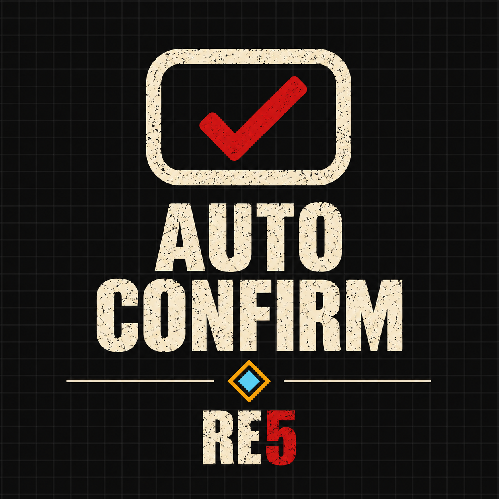

# RE5 Auto Confirm

[English](README.md)



Resident Evil 5 Steam PC DirectX 9의 OK 단일 시스템 알림을 자동 확인하는 모드입니다. 예·아니요 선택은 직접 조작합니다. 부가 기능으로 저장·불러오기 표시 단축, 일시 정지와 로컬 협동 입력 분리, 컷신 스킵 버튼 추가, 시작 영상·로고 스킵을 제공합니다.

## 설치·업그레이드

1. 게임을 종료합니다. Steam에서 Resident Evil 5를 오른쪽 클릭 → 관리 → 로컬 파일 보기를 선택합니다.
2. ASI 로더가 필요합니다. 게임에서 이미 작동하는 ASI 로더를 사용하세요. 이 패키지에는 로더가 포함되어 있지 않습니다.
3. 게임 폴더와 그 안의 `scripts`·`plugins` 폴더에서 `RE5.UISpeedTweaks.asi`, `RE5.CoopInput.asi`, `RE5.CutsceneSkip.asi`, `RE5.ConvenienceTweaks.asi`를 제거합니다. 복원하려면 게임 폴더 밖에 복사해 두세요. 기존 INI 설정은 자동으로 가져오지 않습니다. Convenience Tweaks에서 업그레이드할 때는 `RE5.ConvenienceTweaks.ini`를 `RE5.AutoConfirm.ini`로 복사하면 설정을 유지할 수 있습니다. 새 모드를 설치하기 전에 기존 ASI를 제거하세요.
4. `dist`의 `RE5.AutoConfirm.asi`를 `re5dx9.exe` 옆에 복사합니다. 처음 설치한다면 `RE5.AutoConfirm.ini`도 복사하고, 업그레이드라면 이전 설치에서 복사한 INI를 유지하세요. 한 벌만 설치한 뒤 게임을 시작합니다.

기존 ASI가 감지되면 통합 모드는 작동하지 않습니다. 이름을 바꾸거나 다른 폴더에서 불러와 이 검사를 우회하지 마세요. 같은 코드를 수정하는 모드도 해당 기능의 작동을 막을 수 있습니다. ASI 옆의 `RE5.AutoConfirm.log`를 확인하세요.

지도·Partner AI·Inventory Tweaks·한글 패치는 별도 모드이며 포함되어 있지 않습니다. 업그레이드할 때 해당 파일은 유지하세요.

## 설정·조작

메모장으로 `RE5.AutoConfirm.ini`를 엽니다. `[Features]`에서 `1`은 사용, `0`은 게임 재시작 후 원래 동작으로 복원입니다.

| 설정 | 기본값 | 효과 |
| --- | --- | --- |
| `AutoConfirmOK` | 1 | OK 단일 시스템 알림 자동 확인. 예·아니요 선택은 직접 조작 |
| `ShortSaveMessages` | 1 | 저장·불러오기 메시지의 최소 표시 시간 단축. 실제 파일 처리는 정상적으로 완료 |
| `CoopInput` | 1 | Esc/Start로 일시 정지, 일시 정지 화면에서 Shift+Esc 또는 LB+Start로 로컬 협동 참가 요청 |
| `ExtraSkipButtons` | 1 | 기존 Back 외 컨트롤러 X/A로도 컷신·이벤트신 스킵 |
| `UnlockSkipRestrictions` | 0 | 이벤트 스킵 시간 제한과 일부 이벤트 스킵 금지 해제 |
| `SkipStartupMovies` | 0 | 원래 종료 경로를 이용해 시작 영상과 CAPCOM/Dolby 로고 스킵 |

`[Timing]`에서 `AutoConfirmSeconds`와 `SaveMessageSeconds`를 조절합니다(각각 0~30초, 기본 0.1초). 여섯 기능을 모두 `0`으로 두면 원래 동작을 유지합니다. 설정 변경 후에는 게임을 재시작하세요. 메뉴·선택 효과음·타이틀 Start 대기·배경 전환·메뉴 페이드는 원래 속도를 유지합니다. 이전 메뉴·페이드 설정은 더 이상 사용하지 않습니다.

기존 Back 스킵도 사용할 수 있습니다. 협동 스킵 확인 절차, 게임 중 액션·재장전·지도 조작과 기존 화면의 스킵 안내는 유지합니다. 로컬 협동은 게임의 기존 장치·세션 조건을 충족해야 합니다.

## 한계

코드가 일치하는 32비트 Steam DX9 버전만 지원합니다. 다른 판본이나 같은 코드의 충돌이 있으면 해당 기능을 적용하지 않습니다. 일부 기능이 비활성 상태여도 다른 기능은 작동할 수 있습니다.

시작 스킵은 기본 꺼짐이며 타이틀 화면, 등급·주의 화면과 기존 세이브 확인 절차를 유지합니다. 잠깐의 영상 프레임이나 페이드가 보일 수 있습니다. 시작 스킵은 실험적 기능입니다. 세이브 오류가 나타나면 세이브 생성·교체에 동의하지 말고 종료한 뒤 `SkipStartupMovies=0`으로 바꾸고 재시작하세요.

`UnlockSkipRestrictions`는 실험적 기능이며 기본 꺼짐입니다. 금지 해제를 켠 상태에서 6-3 비행기 웨스커 전투 컷신을 Back 또는 X/A로 스킵하면 장면이 처음부터 재생된다는 제보가 있으며, 원인은 미해결입니다. 다른 QTE·보스 연계 장면도 일찍 끝내면 진행이 막힐 수 있습니다. 일반 플레이에서는 이 옵션을 꺼두세요. 장면이 반복되거나 진행이 막히면 옵션을 끄고 게임을 재시작한 뒤 체크포인트를 다시 불러오세요. 금지 해제를 꺼도 원래 스킵 가능한 장면에서는 X/A를 사용할 수 있습니다.

UI 대기 시간 단축은 렌더러 멈칫거림이나 한글 번역·글꼴 문제를 해결하지 않습니다.

## 제거·기존 모드 복원

게임을 종료하고 `RE5.AutoConfirm.asi`를 삭제합니다. INI와 로그도 삭제해도 됩니다. 기존 모드로 돌아가려면 통합 ASI를 제거한 다음 기존 ASI와 그에 맞는 INI를 복원하세요. 이 모드는 게임 실행 파일과 세이브 파일을 패치하지 않습니다.

## 빌드

Python 3, 호스트 C 컴파일러, PATH에 등록된 `i686-w64-mingw32-gcc`가 필요합니다.

```sh
python3 build.py
```

결과물은 `dist`에 생성됩니다. 합성 Windows 검사는 빌드 후 프로젝트를 Python이 설치된 Windows로 복사하여 `python tests/run_windows.py`로 실행합니다. 이 검사는 게임을 실행하지 않습니다.

## 제작·라이선스

제작: [eggu](https://github.com/eggu). Resident Evil 5의 권리는 CAPCOM에 있습니다. ASI 로더는 별도 프로젝트이며 포함되지 않습니다. 소스 코드는 [MIT 라이선스](LICENSE)로 제공합니다. 표지 이미지는 제작자의 다른 모드 로고 스타일을 바탕으로 AI 이미지 생성 도구로 제작했습니다.
